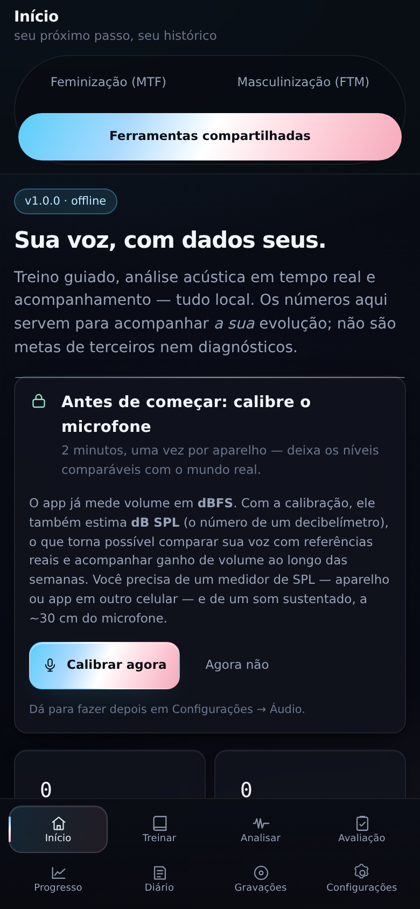
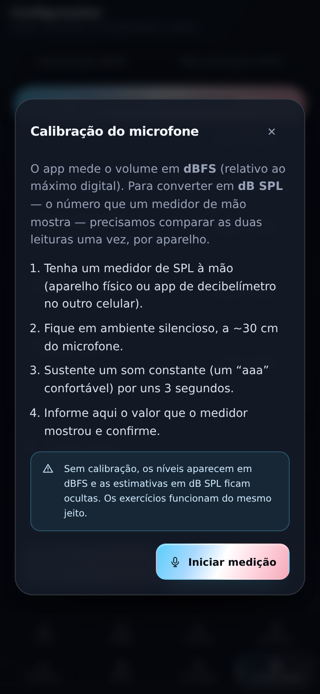
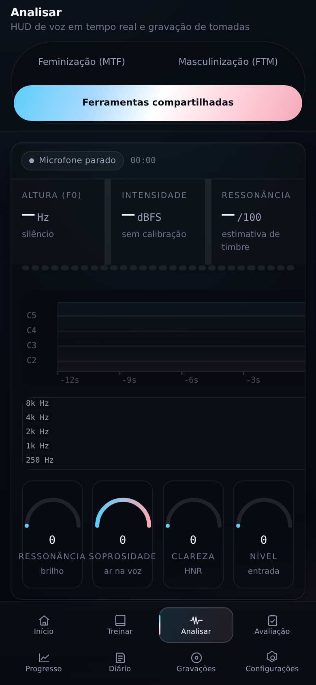
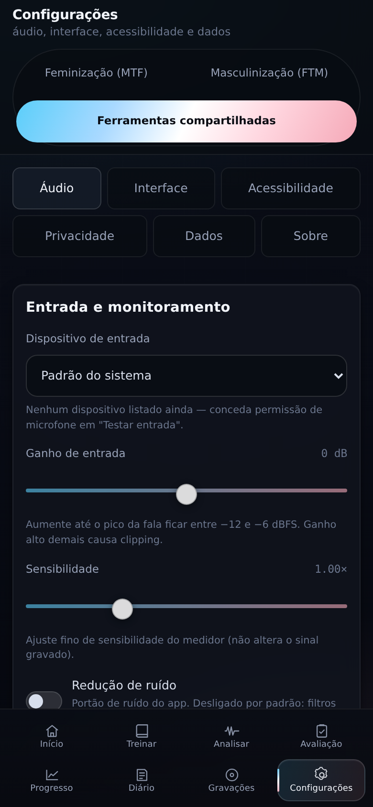

# Prisma Vocal — Android

**Treino, análise e acompanhamento de voz no celular — offline, local e com os dados cifrados no aparelho.**

Este repositório é o alvo **Android** do Prisma Vocal (Capacitor + WebView). O aplicativo de mesa está em
[prisma-vocal](https://github.com/yuki-dev-bit/prisma-vocal). O renderer (`src/`) é o mesmo nos dois
projetos: interface, análise acústica e regras são compartilhadas; aqui muda apenas quem responde ao
armazenamento (IndexedDB cifrado no WebView) e às funções de sistema (compartilhar, notificações).

[](LICENSE)
-8ee6c8?style=flat-square)


> **Prisma Vocal não é diagnóstico médico.** As medidas são estimativas acústicas para acompanhar a
> *sua* evolução. Se houver dor ou rouquidão persistente, procure um(a) fonoaudiólogo(a).

## Capturas

| Início | Calibração guiada |
| --- | --- |
|  |  |

| Análise ao vivo | Configurações |
| --- | --- |
|  |  |

## O que o app faz

- **HUD ao vivo**: altura (f0), ressonância, soprosidade, HNR, formantes e nível, com histórico de 14 s.
- **Treino guiado**: módulos progressivos com metas proporcionais ao seu perfil vocal.
- **Avaliação**: protocolo de 7 etapas que mapeia piso, centro, teto e extensão (~4 min).
- **Gravações**: ouvir, comparar A/B, exportar WAV (via folha de compartilhamento).
- **Calibração do microfone**: converte dBFS em dB SPL estimado e fica salva no aparelho.
- **Diário, metas e progresso**, com retenção configurável e "apagar tudo".
- Tudo local: sem conta, sem nuvem, sem telemetria. Só 4 permissões (microfone, áudio-config, internet
  do WebView e notificações).

## Requisitos

| Para | Precisa de |
| --- | --- |
| Instalar o APK | Android 7.0 (API 24) ou superior, ~40 MB livres |
| Compilar | Node.js **22+** (o Capacitor CLI exige ≥ 22), JDK 21, Android SDK (compileSdk 36, Build-Tools 36) |
| Testar layout | Node 22+ (Playwright baixa o Chromium na primeira execução) |

## Instalação (usuário final)

1. Baixe o APK na página de **releases** (`PrismaVocal-1.0.1.apk`).
2. Ao abrir o arquivo, autorize "instalar de fonte desconhecida" para o app de onde veio (WhatsApp,
   Drive, navegador).
3. Na primeira execução, permita o **microfone** — sem isso o medidor fica parado.
4. Comece pela **Avaliação** (4 min). Se quiser níveis em dB SPL, faça a **calibração** no convite da
   tela inicial.

O APK é assinado; a atualização por cima só funciona se for assinada com a mesma chave (veja
[docs/ANDROID.md](docs/ANDROID.md#versão-de-release-assinada)).

## Compilar a partir do código

```bash
git clone https://github.com/yuki-dev-bit/prisma-vocal-android.git
cd prisma-vocal-android
npm install
npm run mobile:sync         # build do renderer + `cap sync` (gera dist/ e copia para android/)
cd android
./gradlew assembleDebug     # APK de teste
./gradlew assembleRelease   # APK de distribuição (precisa da chave)
```

O APK sai em `android/app/build/outputs/apk/`. Instalar no aparelho conectado:

```bash
adb install -r android/app/build/outputs/apk/debug/app-debug.apk
```

`android/app/src/main/assets/public/` é cópia gerada pelo `cap sync` e **não** está no
repositório: rode `npm run mobile:sync` depois de cada mudança em `src/`.

Passo a passo completo (SDK, assinatura, keystore, problemas comuns): **[docs/ANDROID.md](docs/ANDROID.md)**.

## Verificações automatizadas

```bash
npm run typecheck       # TypeScript estrito (renderer + núcleo)
npm run lint            # ESLint (typescript-eslint + regras de hooks)
npm run format:check    # Prettier
npm test                # testes de núcleo (DSP, análise, calibração, manifesto Android…)
npm run build:renderer  # build de produção do WebView
npm run smoke:android   # bridge Android cifra/decifra e persiste (Chromium)
npm run test:mobile     # 7 tamanhos × 8 telas: overflow, alvo de toque, texto cortado
npm run smoke:mic       # captura, calibração e persistência com microfone sintético
npm run test:coverage   # testes + cobertura de src/core e src/shared (piso em vitest.config.ts)
npm run verify          # typecheck + lint + formatação + cobertura + build + smoke do bridge
```

São **333 testes em 20 arquivos**. A cobertura é medida só em `src/core` e `src/shared`
(o renderer é validado pelos smokes em Chromium, não por linha):

| Métrica | Medido | Piso |
| --- | --- | --- |
| statements | 97,9% | 95% |
| branches | 91,5% | 88% |
| functions | 99,6% | 97% |
| lines | 99,5% | 97% |

Nada de `/* v8 ignore */` nem módulo de lógica fora do relatório: só ficam de fora
`src/shared/types.ts` (só tipos, zero linha executável), o que não carrega em Node
(o processo principal do desktop, o AudioWorklet, o bridge nativo — cobertos pelos smokes) e a
interpolação de variáveis
do `translator`, que nenhuma string usa hoje.

## Segurança e privacidade

| Camada | Medida |
| --- | --- |
| Permissões | `RECORD_AUDIO`, `MODIFY_AUDIO_SETTINGS` (exigida pelo WebView), `INTERNET` (só para `https://localhost`), `POST_NOTIFICATIONS` |
| Backup do sistema | `allowBackup="false"` — dados e chave não vão para o Google |
| Tráfego | `usesCleartextTraffic="false"` + `network_security_config` |
| CSP do WebView | `default-src 'self'; connect-src 'self'` — nenhuma requisição externa |
| Dados | AES-GCM 256 com `CryptoKey` **não-extraível** no IndexedDB |
| Links | `openExternal` só abre `https://github.com/yuki-dev-bit` |
| "Apagar tudo" | remove dados **e** a chave — o que sobrar é ilegível |

Modelo de ameaça completo: [docs/PRIVACY.md](docs/PRIVACY.md) e [SECURITY.md](SECURITY.md).

## Limitações

- Não é app médico e não avalia saúde vocal.
- WebView suspenso em segundo plano interrompe a captura (comportamento do Android).
- Microfone com AGC ou Bluetooth altera as medidas — a calibração é por aparelho e microfone.
- Com root, alguém pode ler o banco do WebView e pedir a decifragem (a chave não é exportável, mas o
  processo roda no mesmo aparelho).
- Sem Play Store: distribuição por APK.

## Licença

MIT — veja [LICENSE](LICENSE). Contribuições: [CONTRIBUTING.md](CONTRIBUTING.md).
